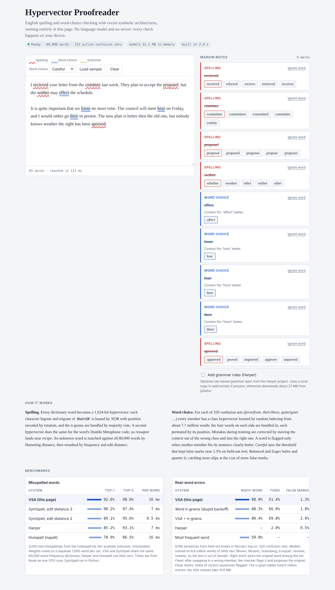

# Hypervector Proofreader

English spelling, real-word error checking ("form" vs "from", "loose" vs "lose") and sentence
interpretation built on **vector symbolic architectures** (VSA, hyperdimensional computing). It
runs entirely in the browser, with no language model and no server. An optional grammar layer
comes from [Harper](https://github.com/Automattic/harper).

The page has two modes:

- **Proofread text** marks spelling and word-choice errors in a document.
- **Interpret a sentence** returns the most probable intended sentence over a dictionary you
  choose (general English, the agent-command preset, or your own words and example sentences),
  with alternatives. Use it in front of a semantic parser or an agent:
  `opne teh fiel` → `open the file`, using only words your parser knows. See
  [docs/DECODER.md](docs/DECODER.md).



Live page (once GitHub Pages is on): <https://ml-circuits-research.github.io/vsa-spell/>

## Run it on your computer

Requirements: Node.js 18 or newer. The trained models are committed, so nothing needs training.

```bash
git clone https://github.com/ml-circuits-research/vsa-spell.git
cd vsa-spell
npm run serve          # no install needed for the demo
```

Open <http://127.0.0.1:8080/>. Proofreading downloads about 6 MB of models and builds 80,000
word hypervectors in about 2 seconds; the Interpret tab downloads about 8 MB more the first time
it opens. Models are kept in the browser's Cache Storage, so later visits download nothing.

A local web server is required: browsers will not start the module Web Worker from a `file://` URL.
`python3 -m http.server 8080 -d docs` works as well.

### Publish with GitHub Pages

The page lives in `docs/`, so no build step is needed: in the repository's **Settings → Pages**,
set **Source** to *Deploy from a branch*, branch `main`, folder `/docs`. `docs/.nojekyll` makes
Pages serve the files as they are. On Pages, `docs/vendor/` is not committed, so the Harper
layer loads from jsDelivr.

### Add the Harper grammar layer

Tick **Add grammar rules (Harper)** in the page. By default the page loads Harper 2.10.0 from
jsDelivr (about 27 MB). To run fully offline instead:

```bash
npm install
npm run vendor:harper  # copies Harper into docs/vendor/harper.js
npm run serve
```

The page then loads Harper from `docs/vendor/` with no network access. Details, versions and
troubleshooting: [docs/HARPER.md](docs/HARPER.md).

## What is in the page

| Layer | Method | Size in memory |
|---|---|---|
| Spelling | 80,000 words as 1,024-bit hypervectors (character bigrams + trigrams, XOR binding, rotation for position, majority bundling) plus a Double Metaphone hypervector; Hamming search, rerank by frequency and edit distance | 20.5 MB |
| Word choice | 320 confusion sets; one class hypervector (D = 16,384, 4 bits) per word, learned by sparse random indexing over ±4 words of context with HDC retraining | 5.3 MB download, 10.6 MB in memory |
| Grammar (statistical) | part-of-speech tag bigrams and P(tag \| word) from the tagged Brown corpus, Viterbi | 0.9 MB file |
| Sentence context | word-context hypervectors for the 30,000 most frequent words (D = 1,024, 2 bits) | 7.7 MB download, 30.7 MB in memory |
| Grammar (optional) | Harper's rule-based linter (its spelling rules are hidden) | about 27 MB |

Download sizes: proofreading 6 MB, interpretation 8 MB more, Harper 27 MB more (optional).
The hypervectors are shipped at 4 and 2 bits; see [Model size](docs/BENCHMARKS.md#model-size).

How it works in detail: [docs/ARCHITECTURE.md](docs/ARCHITECTURE.md).

## Results

Misspelled words: 3,000 real misspellings from the codespell list, test set never used for tuning.

| System | Top-1 | Top-5 | Per word |
|---|---:|---:|---:|
| **VSA (this repo)** | **92.6%** | **98.6%** | 16 ms |
| SymSpell, edit distance 3 | 90.2% | 97.4% | 7 ms |
| SymSpell, edit distance 2 | 89.1% | 95.6% | 0.5 ms |
| Harper | 85.2% | 93.1% | 7 ms |
| Hunspell (nspell) | 78.9% | 86.5% | 16 ms |

Real-word errors: 9,198 held-out sentences, 320 confusion sets, models trained on 6.8M words of
other text (out of domain).

| System | Right word | Fixed | False marks |
|---|---:|---:|---:|
| **VSA (this repo)** | 88.0% | 51.4% | 1.2% |
| Word n-grams (stupid backoff) | 88.3% | 66.0% | 1.8% |
| VSA + n-grams | 89.4% | 69.8% | 2.0% |
| Harper | — | 2.0% | 0.5% |

The VSA context model is on par with word n-grams at picking the right word and ships in 5.3 MB
instead of about 6 million n-gram entries; n-grams are still better at flagging errors at a low
false-alarm rate. Full numbers, earlier rounds and caveats: [docs/BENCHMARKS.md](docs/BENCHMARKS.md).

Sentence interpretation (details in [docs/DECODER.md](docs/DECODER.md)):

| Test | System | Sentences right | False changes |
|---|---|---:|---:|
| 1,000 general sentences, 0–2 errors | **Decoder** | **64.7%** | 0.64 / 100 words |
| | Proofread mode | 49.3% | 1.16 |
| | Harper, first suggestions | 43.2% | 4.03 |
| 600 agent commands, 0–2 typos | **Decoder, own dictionary + examples** | **99.7%** | 0 |
| | Spelling only, own dictionary | 92.8% | 0 |
| | Spelling only, general dictionary | 56.8% | 0 |

## Use the decoder from code

```js
import { loadDecoder } from './src/load-decoder.mjs';
const dec = await loadDecoder({ dictionary: myWords, examples: myExampleCommands });
dec.decode('creat a new fodler nmaed reports').best.text;  // 'create a new folder named reports'
```

`npm run example:agent` shows it in front of a toy command parser.

## Repository layout

```
docs/       the demo (index.html, worker.js, vsa-core.js and decoder.js shared with Node, models) and the
            documentation; GitHub Pages publishes this folder
src/        corpus building, confusion-set mining, training, benchmarks, load-decoder.mjs (Node API)
examples/   agent-pipeline.mjs: decoder in front of a command parser
scripts/    static server, Harper vendoring, data download
results/    JSON outputs of the benchmark runs
tests/      headless browser test (Playwright)
data/       confusions.json (other data files are downloaded, see docs/REPRODUCE.md)
```

## Reproduce or retrain

See [docs/REPRODUCE.md](docs/REPRODUCE.md). In short: `npm install`, `pip install -r requirements.txt`,
`npm run data:fetch`, `npm run data:build`, then the `bench:*` and `train:context` scripts.

## Licenses

Code in this repository: MIT. `docs/double-metaphone.js` is Titus Wormer's double-metaphone (MIT).
`docs/words.txt` is SymSpell's English frequency dictionary (MIT). Harper is Apache-2.0 and is not
committed; it is loaded from npm or the CDN.
